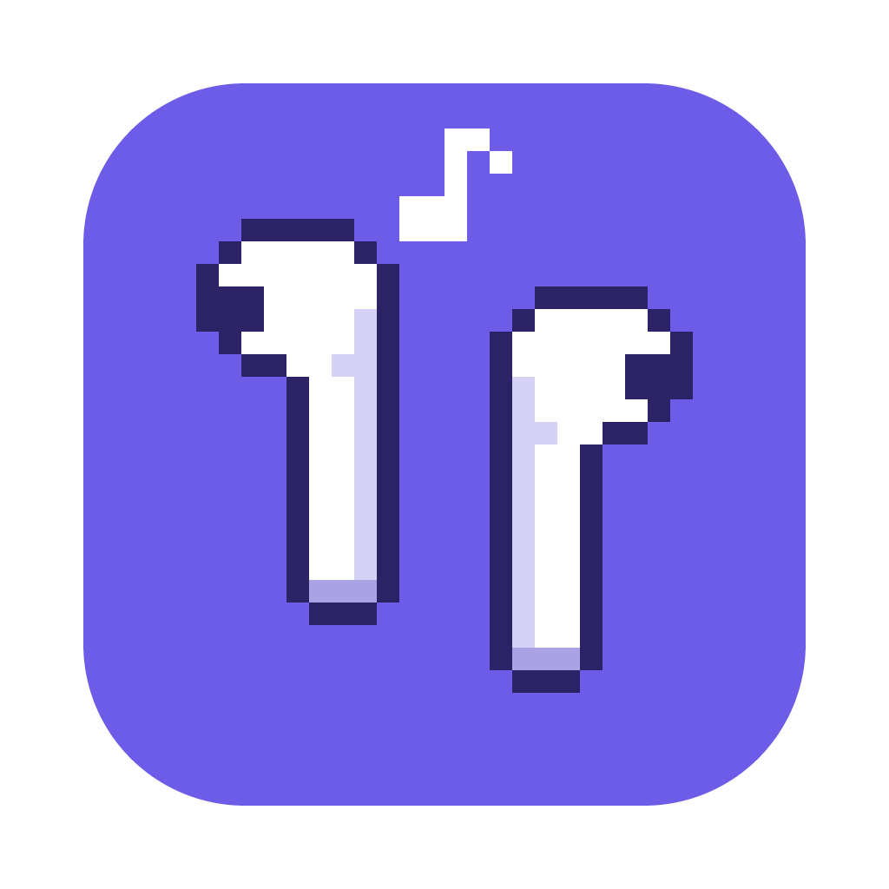

# Oasi



_Tu espacio de estudio._ (Nombre interno del proyecto: Student OS.)

Asistente de escritorio para estudiantes universitarios. 100% local y offline.

**Stack:** Electron · electron-vite · React 19 · TypeScript · Tailwind CSS v4 · SQLite (better-sqlite3) · Drizzle ORM · zod

## Comandos

```bash
npm install        # también descarga el binario de Electron (postinstall)
npm run dev        # app en modo desarrollo con HMR
npm run typecheck  # tsc para main/preload y renderer
npm run build      # typecheck + bundle en out/
npm run dist       # empaqueta instalador con electron-builder (release/)
npm test           # tests de la capa de datos (SQLite en memoria)
npm run db:generate  # tras editar src/main/db/schema.ts: genera migración en drizzle/
npm run db:studio    # explorador visual de la DB de desarrollo
```

## Estructura

```
src/
  main/       Proceso principal (Node): ventanas, IPC, y luego DB/archivos/APIs
  preload/    Puente seguro: expone window.studentOS vía contextBridge
  renderer/   UI React + Tailwind (sin acceso a Node)
  shared/     Tipos y contrato IPC compartidos por los tres
```

Seguridad: `contextIsolation`, `sandbox` y `nodeIntegration: false`, más una CSP estricta.
El renderer sólo habla con Node a través de los canales definidos en `src/shared/ipc.ts`.

## Datos

Todo vive en una única base SQLite local (`userData/student-os.db`; en dev, `Student OS (dev)/`).
Las migraciones de `drizzle/` se aplican solas al arrancar.

| Tabla | Para qué |
|---|---|
| `subjects` | Materias (color, dificultad 1–5 para el planificador) |
| `events` | Clases, parciales, entregas. `source` = `manual` o `google` (solo lectura) |
| `documents` | PDFs guardados en `userData/library`, con progreso de lectura |
| `notes` | Apuntes en Markdown; los deep links son `studentos://anchor/<id>` |
| `pdf_anchors` | Destino de cada deep link: documento, página y rectángulos normalizados |
| `check_ins` | Nivel de energía y materia urgente declarados al empezar |
| `study_sessions` | Cronómetro: tiempo activo por día local → heatmap, rachas, estadísticas |
| `settings` | Preferencias clave/valor (tema, pomodoro…) |

Flujo: `renderer → window.studentOS (preload) → IPC → validación zod → repositorio → SQLite`.

## Temas

Tres temas (Zen, Enfoque, Arcade) definidos como **tokens CSS** en `src/renderer/src/styles/globals.css`
sobre `<html data-theme="…">`. Tailwind los expone como utilidades semánticas (`bg-canvas`, `bg-surface`,
`text-fg-muted`, `border-line`, `bg-accent`, `bg-heat-0…4`, `shadow-glow`…), así que ningún componente
usa colores fijos. Para matices de un tema puntual: variantes `zen:`, `focus-mode:` y `arcade:`.

El tema guardado se pasa al preload como argumento y se aplica antes del primer pintado (sin destello),
y el fondo nativo de la ventana lo acompaña.

## Atajos

| Atajo | Acción |
|---|---|
| ⌘/Ctrl + 1…5 | Inicio · Calendario · Estudio · Materias · Estadísticas |
| ⌘/Ctrl + , | Ajustes |
| ⌘/Ctrl + ⇧ + T | Siguiente tema |
| ⌘/Ctrl + \ | Colapsar barra lateral |

## Workspace (Estudio)

Pantalla dividida: visor de PDF (pdf.js con capa de texto) a la izquierda y editor Markdown (TipTap) a la derecha.

- **PDFs:** se arrastran desde el Finder/Explorador o con "Importar". Se copian a `userData/library/<materia>/<id>.pdf`
  (deduplicados por SHA-256). El visor recuerda la última página y registra la más alta leída.
- **Apuntes:** Markdown con fórmulas KaTeX (`$…$`, `$$…$$`) y bloques de código con resaltado. Autoguardado.
- **Deep links:** seleccioná texto (o activá *Recortar área* para figuras/fórmulas) y arrastralo al apunte, o usá
  *Insertar en apunte*. Se guarda un ancla con la página y rectángulos normalizados, y en el Markdown queda
  `[“texto” · p. 12](studentos://anchor/<id>)`. Al hacer clic se abre el PDF en esa página y se resalta la zona.
- Atajos del visor: ⌘ + rueda para zoom, Esc cancela la selección/recorte.

## Diseño (estilo Discord, identidad propia)

- **Riel de materias** (izquierda): cada materia es un "servidor" con sus iniciales y color. El ícono pasa de
  círculo a squircle; la píldora indicadora toma el color de la materia y el badge rojo marca los días al
  próximo parcial/entrega (≤ 7 días).
- **Canales**: en Inicio, `# inicio · calendario · estudio · materias · estadísticas`; dentro de una materia,
  `estudio · fechas · progreso` + sus PDFs y apuntes.
- **Panel de usuario** (abajo): racha 🔥, sesión libre, tema y ajustes. Con una sesión activa aparece el
  **dock de sesión** (como "voz conectada"): fase, reloj, pausa, saltar y terminar.
- **Encabezado de canal** con la cuenta regresiva al próximo evento.

## Planificación y hábitos

- **Check-in** (al abrir la app, una vez por día): energía baja/media/alta + materia urgente. Teclas 1/2/3 y Enter.
- **Planificador** (`src/shared/planner.ts`, determinístico y testeado): prioriza por fechas (peso / días
  restantes), dificultad y energía; la materia urgente va primero; intercala materias; respeta las clases y
  corta a las 23 h (con opción "Planificar mañana"). Cada bloque explica sus razones y, si hay PDF, cuántas
  páginas leer (páginas restantes ÷ días al hito).
- **Cronómetro** (`src/shared/timer.ts`): pomodoro adaptado al bloque sugerido, basado en timestamps, con
  heartbeat cada 15 s y recuperación de sesiones tras un cierre inesperado. Solo el foco suma al heatmap.
- **Heatmap anual**, **rachas** (mínimo diario configurable, 15 min por defecto) y **estadísticas** por materia
  y por día, con vista de tabla. Colores de materia: paleta categórica validada para daltonismo.

## Asistente de IA

Rol estrictamente organizativo y de destrabe: **no** genera simulacros ni preguntas de examen (lo impone
el prompt de sistema, `src/main/ai/prompts.ts`).

- **Simplificar / Resumir:** seleccioná texto del PDF → clic derecho → «Simplificar con IA» o «Resumir con IA»
  (o el botón «Simplificar» del menú de selección). La respuesta llega en streaming al panel **Asistente**,
  sin salir de la pantalla de estudio, y se puede insertar en el apunte como cita enlazada a esa posición.
- **Plan de lectura:** cruza las páginas que faltan del PDF con los días hasta el parcial y reparte las
  páginas por día (reserva el día previo para repasar; opción de domingos libres). Los números los calcula
  la app (`src/shared/readingPlan.ts`); la IA solo agrega consejos sobre ese plan.
- **Proveedores** (Ajustes → Asistente de IA):
  - **Claude (API de Anthropic):** modelo por defecto `claude-opus-5-5` con esfuerzo bajo y fallback del
    servidor ante rechazos (`fallbacks: "default"`). La API key se guarda cifrada con `safeStorage`.
  - **Ollama (local):** sin internet ni envío de texto a terceros. Instalá Ollama y corré `ollama pull llama3.2`.

## Google Calendar (solo lectura)

1. En Google Cloud Console: creá un proyecto, habilitá **Google Calendar API**, configurá la pantalla de
   consentimiento (Externo, agregate como usuario de prueba) y creá un **ID de cliente OAuth tipo «App de escritorio»**.
2. Ajustes → Google Calendar: pegá Client ID y Secret → **Conectar con Google** (se abre el navegador).
3. Elegí los calendarios con tus clases. Se sincroniza al abrir la app y cada 30 minutos.

OAuth para apps de escritorio (RFC 8252): redirección a `127.0.0.1` con puerto aleatorio, PKCE y `state`;
alcance `calendar.readonly`. Los eventos con horario se importan como **clases** (bloquean el planificador),
asociados a su materia por nombre o código; los de día completo, como «otro». Desconectar revoca el token y
borra los eventos importados. Los secretos y tokens van cifrados en `userData/secrets.json`, nunca al renderer.

## Tests

`npm test` corre 44 tests: capa de datos, biblioteca de PDFs, planificador, cronómetro, rachas, heatmap,
plan de lectura, IA (Ollama y el SDK de Anthropic contra servidores simulados) y Google (OAuth loopback
real con navegador simulado, sincronización, renovación y revocación de tokens).

## Marca e ícono

- **Nombre visible:** Oasi (“oasis” en italiano). Los identificadores internos (carpeta de datos `Student OS`, `appId`, esquema
  `studentos://` de los deep links) no cambian, para no perder datos ni romper enlaces existentes.
- **Ícono:** auriculares inalámbricos en pixel art 32×32 sobre fondo liso, dibujados por código en `src/shared/pixelIcon.ts`.
  `npm run icons` regenera `resources/icon.png` (1024 px, para el instalador) y las 3 variantes
  (Atardecer, Noche, Neón) en `resources/icons/`. La variante se elige en Ajustes y cambia el Dock en vivo.

## Sonidos ambiente

Lluvia, cafetería y ruido blanco/rosa/marrón, **sintetizados en tiempo real con Web Audio** (sin archivos, offline,
sin loops audibles): `src/renderer/src/features/sound/engine.ts`. Acoplados al cronómetro: arrancan con el foco,
se silencian al pausar y (opcionalmente) en los descansos. Todo se configura o desactiva en Ajustes → Sonidos ambiente.
